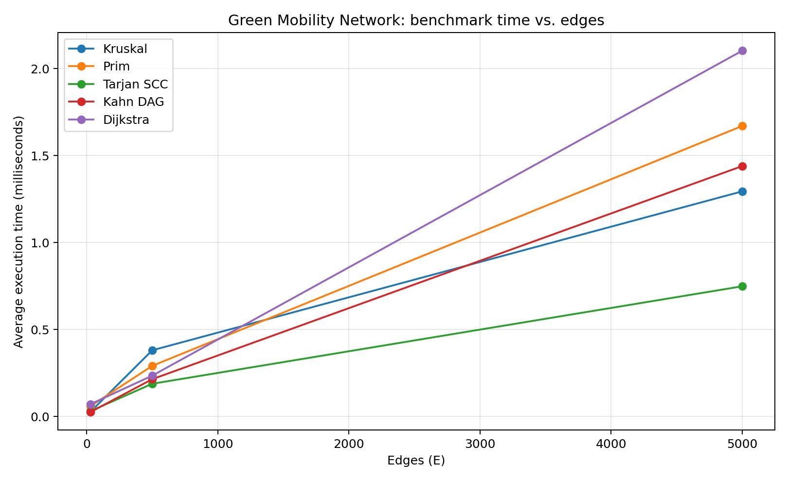

# Smart City — Green Mobility Network

**Assignment 3 — Smart City Infrastructure and Route Planning**  
**Student:** Mereylim Saparova  
**Programming language:** Java 17+ (tested with OpenJDK 21)

## 1. Overview

This independent implementation models six green mobility districts: Solar Square, River Gardens, Eco Campus, Innovation Park, Central Station, and Wind District. Undirected, weighted edges represent road construction costs or distances. Directed edges represent one-way travel and infrastructure dependencies. The application demonstrates network design, connectivity and route planning.

## 2. Implementation

- `Graph`: adjacency lists with distinct directed and undirected graph modes, stored edge list, nonnegative weights.
- `DisjointSet`: path compression and union by **size**.
- `SpanningTrees`: Kruskal sorts edges and uses DSU; Prim expands from vertex zero with a binary-heap priority queue. Both return total weight, selected-edge count, connectivity and operation count.
- `Connectivity`: **Tarjan SCC** with low-link timestamps and stack; **Kahn topological sort** with indegrees and a queue; incomplete order means a cycle.
- `Routes`: heap-based Dijkstra with parent pointers for route reconstruction; unreachable vertices retain `INF`.
- `CityGenerator`: reproducible graphs built with fixed random seeds, unique edges and strictly positive integer weights.
- `Checks`: hand-built correctness examples plus fixed-seed randomized validation.
- `Experiments`: timings and operation counts written to CSV.

A toy road system with six districts produces equal MST weights of **14** for both Kruskal and Prim. The directed one-way example has SCCs `[0,1,2]`, `[3,4]`, and `[5]`.

## 3. Complexity analysis

Let V be the number of vertices, E the number of edges, and α(V) the inverse Ackermann function. Adjacency lists and binary heaps are used.

| Operation or algorithm | Time | Additional space | Notes |
|---|---|---|---|
| DSU `find` / `union` | amortized O(α(V)) | O(V) total DSU storage | Union by size keeps shallow trees; path compression flattens trees during `find`. |
| Kruskal | O(E log E + E α(V)) | O(E + V) | Sorting dominates the running time. |
| Prim | O(E log E) | O(E + V) | Lazy priority queue may contain multiple candidate edges. |
| Tarjan SCC | O(V + E) | O(V) besides graph | DFS stack, index and low-link arrays. |
| Kahn topological sort | O(V + E) | O(V) besides graph | Removes indegree-zero vertices; a partial order signals a cycle. |
| Dijkstra | O((V + E) log V) | O(V + E) besides graph | Lazy heap; requires nonnegative weights. |

**Negative edges:** Dijkstra assumes finalized shortest distances cannot improve via a negative-weight edge. This assumption fails with negative weights; use an algorithm such as Bellman–Ford for graphs that may contain them.

## 4. Experimental setup

| Size | Vertices | Edges |
|---|---:|---:|
| Small | 10 | 30 |
| Medium | 100 | 500 |
| Large | 1000 | 5000 |

All graphs use `java.util.Random` with deterministic seeds based on **94721**. Undirected MST and shortest-path graphs start with an explicit random spanning tree, making them connected, and then gain unique random edges. Directed graphs are sampled without duplicate edges; `Kahn_DAG` graphs only contain edges from a lower index to a higher index (therefore cannot contain cycles). `Kahn_Cyclic` uses unrestricted random directed edges, where cycles are possible and common for the listed densities; topological sorting reports whether a cycle exists. Weights are uniform integers in [1, 90].

Every measured algorithm is run **five times**, after **three unrecorded warmup runs**. `System.nanoTime()` measures algorithm execution, excluding graph generation. The count is a transparent, implementation-defined count of key events (edge scans, queue pops, DSU calls or DFS visits), not CPU instructions; counts are therefore most useful for comparisons within one algorithm. The program writes the full table to `results/tables/benchmarks.csv`. Values can vary by machine, JVM and load. The following numbers were measured on the build environment, not claimed as universal results.

## 5. Results

| Algorithm | 10V / 30E (ms) | 100V / 500E (ms) | 1000V / 5000E (ms) |
|---|---:|---:|---:|
| Kruskal | 0.0285 | 0.3812 | 1.2947 |
| Prim | 0.0602 | 0.2918 | 1.6707 |
| Tarjan SCC | 0.0322 | 0.1887 | 0.7491 |
| Kahn DAG | 0.0266 | 0.2151 | 1.4400 |
| Kahn Cyclic | 0.0050 | 0.0374 | 0.2619 |
| Dijkstra | 0.0717 | 0.2354 | 2.1031 |

**Figure 1: time vs vertices**


**Figure 2: time vs edges**



Full operation counts are in [benchmarks.csv](results/tables/benchmarks.csv).

## 6. Comparison and discussion

Kruskal and Prim always agree on the minimum spanning-tree **weight** in connected undirected graphs, although they can choose different equally optimal edges. Prim explores through heap candidates, while Kruskal sorts all edges and merges DSU components. DSU path compression and union by size prevent long chains and make `find` and `union` almost constant amortized time.

Tarjan's SCC and Kahn's ordering traverse vertices and edges in O(V+E) time. A dense cyclic directed graph may yield an incomplete Kahn order immediately after the indegree pass; this is **not** a valid ordering, and the result's `dag` flag must be checked. Dijkstra's heap and repeated relaxations cost more as graphs grow. Measured time generally increases with graph size, but microbenchmark noise, JIT compilation, garbage collection and the absence of CPU isolation can change the relative ranking. Because V and E increase together in this experiment, both plots visualize the same workloads on different horizontal axes; they do **not** isolate the independent influence of V and E.

## 7. Testing and correctness

Running `city.Main` performs **18 assertions** covering: known MST weight; agreement between Kruskal and Prim; connected/disconnected graphs; a single vertex; duplicate weights and multiple MSTs; DSU; valid DAG topological order; cycle detection; Tarjan SCC groups; coverage by SCCs; known shortest path and route; unreachable vertices; rejection of negative weights; randomly generated MST weight agreement; and generated DAGs. Test failure throws `AssertionError` and stops execution.

## 8. How to run

**IntelliJ IDEA**: Open this project directory, set Java SDK 17 or newer, then open `src/city/Main.java` and click Run next to the `main` method. Configure the working directory as the project root so that `results/` is created correctly.

**Windows PowerShell (from the project root):**

```powershell
New-Item -ItemType Directory -Force out
javac -encoding UTF-8 -d out src/city/*.java
java -cp out city.Main
```

**macOS / Linux:**

```bash
mkdir -p out
javac -encoding UTF-8 -d out src/city/*.java
java -cp out city.Main
```

To regenerate the two PNG charts after running benchmarks, run `python make_plots.py` with Python 3 and Matplotlib installed. The archive already includes both generated PNG plots and the CSV, so Python is not needed for normal Java execution.

## 9. Conclusion

For minimum-cost road connections, Kruskal and Prim provide equivalent optimal total costs, but use different data structures. Tarjan locates mutually reachable zones within one-way routes; Kahn checks construction/service dependency order and flags cycles; Dijkstra provides fast nonnegative shortest-route planning. Each algorithm is appropriate for a different municipal planning question rather than replacing the others.

## Repository deliverables

Source files are in `src/city`; the full CSV is in `results/tables`, and both PNG charts are in `results/plots`. The Java program was compiled and run with OpenJDK 21 for this package; timings and graphics should be regenerated on the student's computer before submitting to document local experimental performance. Use meaningful Git commits when creating and testing your repository.
